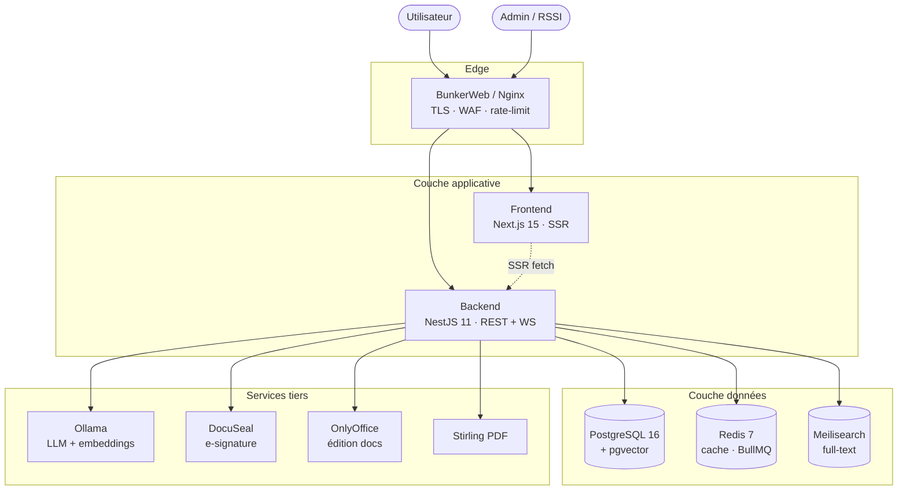
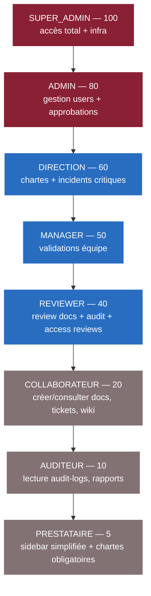
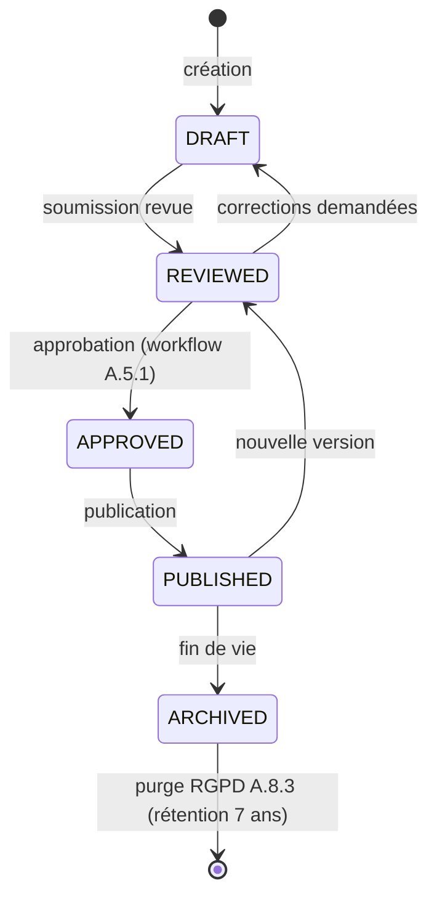
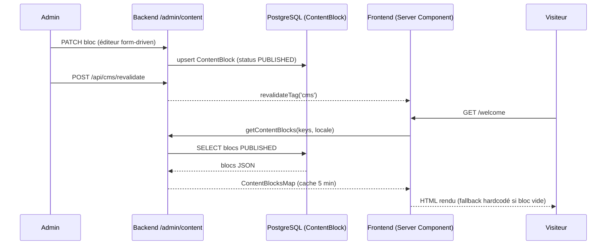
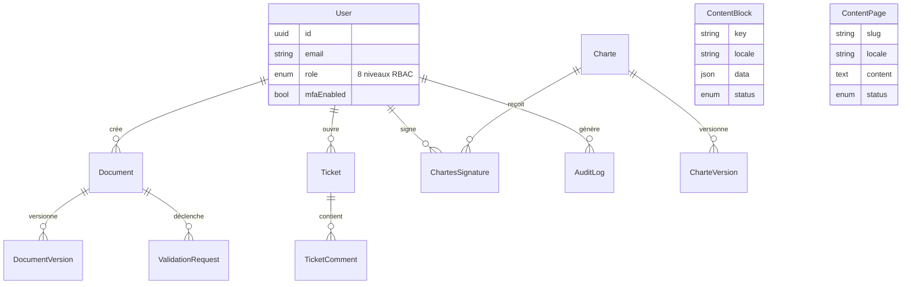

# Diagrammes d'architecture — OMNITECH Intranet

Diagrammes Mermaid (rendus nativement par GitHub). À tenir à jour quand
l'architecture évolue.

## 1. Architecture système (vue déploiement)

## 2. Hiérarchie RBAC (8 rôles)

> Le `RolesGuard` valide via `userRoleLevel >= ROLE_HIERARCHY[requiredRole]`.
> `@Roles(COLLABORATEUR)` autorise donc COLLABORATEUR (20) et tout rôle au-dessus.

## 3. Cycle de vie documentaire (GED)

## 4. Flux CMS (édition → affichage)

## 5. Modèle de données simplifié (entités centrales)

> ERD volontairement simplifié (5 entités sur 102). Schéma complet :
> `packages/database/prisma/schema.prisma`.
